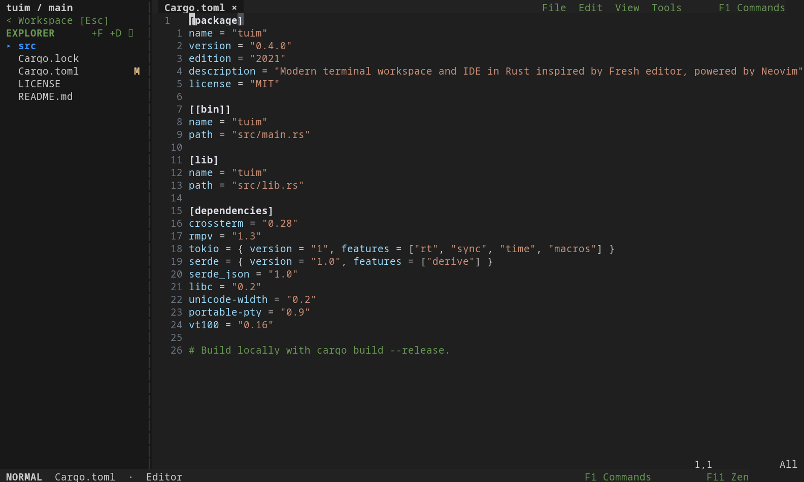
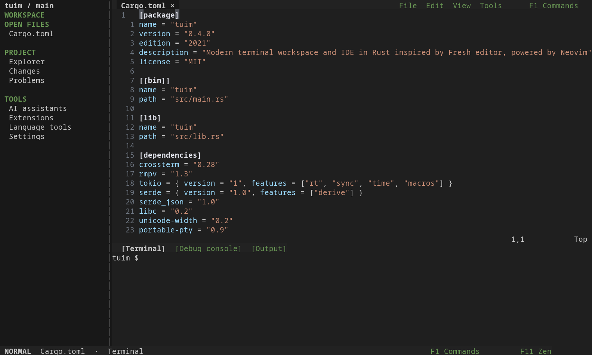
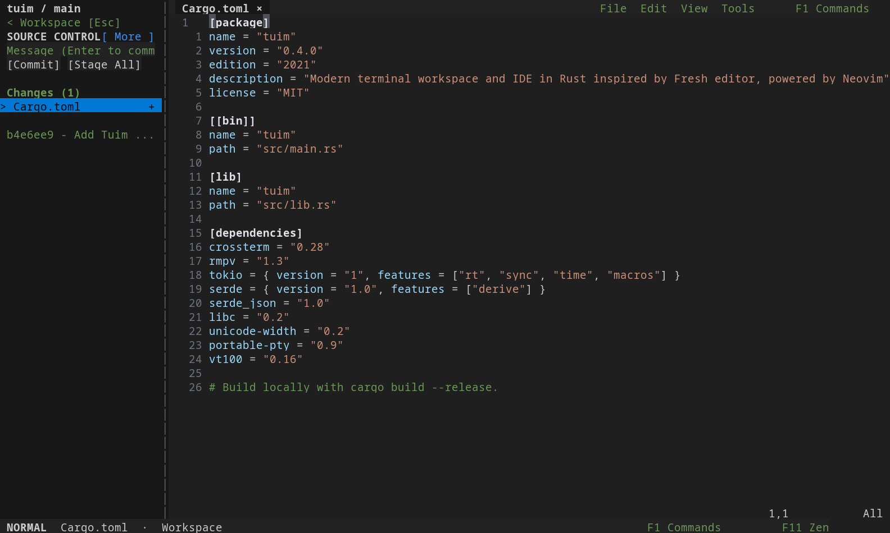
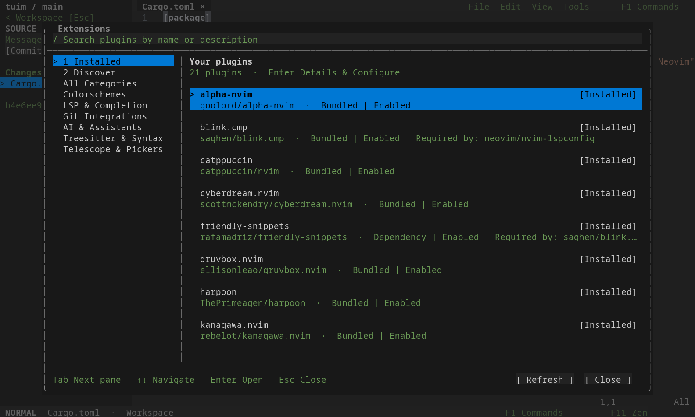
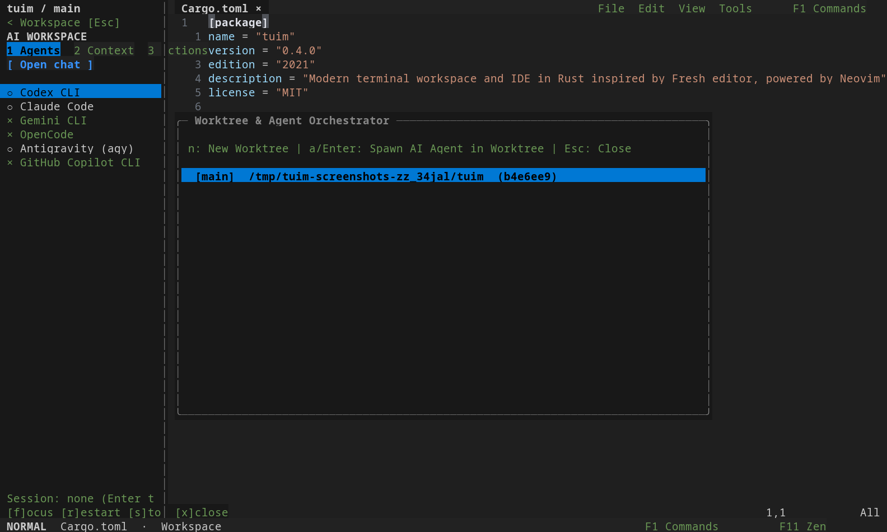

# Rtuim

**Your editor. Your terminal. Now built in Rust.**

Rtuim is the Rust rewrite of [Tuim](https://github.com/Tuim-editor/Tuim),
originally written in Zig. We recoded the app's frontend in Rust while keeping
Neovim as its editing engine. Rtuim is open source under the [MIT license](LICENSE).

Browse files, edit with
Vim motions or familiar IDE shortcuts, run persistent shells, review Git
changes, and open coding assistants without leaving the terminal.
Its configuration and plugins are isolated from your regular Neovim setup.

[Source](https://github.com/Tuim-editor/Rtuim) ·
[Usage guide](docs/usage.md) · [Local wiki](docs/wiki/Home.md) ·
[Rust migration notes](docs/releases/rust-migration.md) ·
[Issues](https://github.com/Tuim-editor/Rtuim/issues)

The executable is still named `tuim` and uses the existing Tuim configuration
and data directories. Installing Rtuim replaces the `tuim` launcher; it does
not create a separate settings profile.



*Real terminal captures of the Rust source build, using portable symbols and
isolated demo data. Plugins are disabled for reproducible captures; these
images do not demonstrate LSP or Treesitter. [Capture details](docs/screenshots/README.md).*

## What you can do

- **Navigate your project:** Explorer, open-buffer tabs, a searchable command
  palette, project text search with ripgrep, and keyboard or mouse navigation.
- **Choose your editing style:** Normal mode for Vim editing, IDE mode for
  modeless editing, and Zen for an uncluttered editor. Split editor windows and
  use mouse selection and context menus.
- **Run native terminals:** persistent bottom and right-side PTY shells with
  scrollback, selection, copy/paste, and terminal-program mouse support.
- **Work with Git:** inspect changes, stage (`+` or `Space`/`s`) and unstage (`-`
  or `u`) files, commit, and open history and branch views.
- **Use language tools:** Neovim LSP, diagnostics, completion, Treesitter,
  Telescope, a native plugin manager, Mason, and the Extensions marketplace.
  Plugin and language-server installation requires network access.
- **Bring coding assistants:** launch installed assistant CLIs and share editor
  context via `Ctrl+Alt+S` / `Ctrl+Alt+F` / `Ctrl+Alt+C` or leader chords. The
  worktree orchestrator lists Git worktrees, creates a branch and worktree, and
  launches Codex in a selected worktree. Each CLI needs its own installation
  and authentication.
- **Make it yours:** native settings, themes, indentation, line numbers, and
  configurable command shortcuts. Default shortcuts retain familiar Ctrl-based
  controls (`Ctrl+E`, `Ctrl+T`, `Ctrl+N`, `Ctrl+P`, `Ctrl+S`, `Ctrl+Q`), while an
  opt-in Vim-safe preset (`v` in Settings > Keybindings) remaps to `Alt+E`, `Alt+T`,
  `Alt+N`, `Alt+P`, `Alt+Q`, and `F2` to free Vim motion and completion keys.

| Native shell | Git changes |
| --- | --- |
|  |  |

| Extensions | Worktree orchestrator |
| --- | --- |
|  |  |

## Build from source

Use a current stable **Rust toolchain with Cargo**, a C linker, **Neovim 0.12
or newer**, and Git. Python 3 supports Extensions; ripgrep supports project
search. A Nerd Font is optional: portable symbols are available in Settings.

```bash
git clone https://github.com/Tuim-editor/Rtuim.git
cd Rtuim
cargo build --locked --release
./target/release/tuim
```

This repository contains the Rust rewrite and reports version **0.4.0** from
`Cargo.toml`. It is a source preview; packaged Rtuim releases are not yet
published. The original Zig version remains in the Tuim repository.

For a user-local installation from this checkout:

```bash
bash setup.sh --source --yes
```

Source setup uses your installed Rust/Cargo toolchain and installs a private
Neovim if needed. It prepares plugins and the default parser set, then links
`~/.local/bin/tuim`. `--no-plugins` skips plugin/parser bootstrap. Add
`~/.local/bin` to `PATH` if needed. Zig is no longer a build dependency.

## Release packages

The Cargo release workflow builds native bundles on Linux x86-64 and ARM64,
and macOS Intel and Apple Silicon. Each bundle contains a launcher, the Rust
executable, and private Neovim. A Linux x86-64 AppImage is also supported.
**The new Rust packages must be built and published before the public installer
can deliver this rewrite.**

```bash
# Once Rtuim release packages are published:
curl -fsSL https://raw.githubusercontent.com/Tuim-editor/Rtuim/main/setup.sh | bash
```

The installer verifies SHA-256 checksums, asks before installing missing system
packages, and preserves settings on upgrade. Options: `--dry-run`, `--yes`,
`--source`, and `--no-plugins`. It does not silently compile when a native asset
is unavailable. See [AppImage and packaging](docs/appimage.md).

Linux is the locally tested platform. macOS builds require native validation;
Windows users should use WSL. The Rust frontend currently uses Unix APIs and
is not a native Windows application. See [terminal compatibility](docs/terminal-compatibility.md).

## Getting started

Launch `tuim`, `tuim path/to/file`, or `tuim file1 file2`. In Normal mode press
`i` to type and Escape to return to Vim commands. In IDE mode start typing
immediately. Select the editing style from the footer mode badge; **F11**
toggles Zen and returns to the previous style.

| Action | Default shortcut |
| --- | --- |
| Search commands | `F1` |
| Show, focus, or hide Explorer | `Ctrl+E` (or `Space e` in Normal mode) |
| Show, focus, or hide the bottom shell | `Ctrl+T` |
| Next / previous workspace region | `F6` / `Shift+F6` |
| Resize panels | `Alt+Arrow` (`Alt+←`/`Alt+→` sidebar/vertical terminal divider, `Alt+↑`/`Alt+↓` bottom shell divider; visible Zen panes resize) |
| Report bug | `F12` |
| New file / save / find file | `Ctrl+N` / `Ctrl+S` / `Ctrl+P` |
| Project text search | `Alt+G` |
| Toggle Zen | `F11` |
| Quit, checking unsaved buffers | `Ctrl+Q` |
| Toggle bottom / right shell in Normal mode | `Space o t` / `Space o T` |
| Horizontal / vertical editor split | `Alt+S` / `Alt+V` (or `Ctrl+W s` / `Ctrl+W v`) |
| Close current editor split | `Alt+C` (or `Ctrl+W q`) |
| Send to AI assistant | `Ctrl+Alt+S` (selection), `Ctrl+Alt+F` (file path), `Ctrl+Alt+C` (content) or leader `Space a s/f/c` |

When a native shell is focused, ordinary editing shortcuts go to the shell.
Use F1 commands or F6 / Shift+F6 to navigate between editor and shell panels.
The first save of an unnamed buffer prompts for a filename. Hide a terminal
to preserve its process; after a shell exits, Enter starts a new one.

Drag over terminal text, then use `Ctrl+C` or `Ctrl+Insert` to copy; without a
selection Ctrl+C interrupts the running program. Paste with `Ctrl+V` or
`Shift+Insert`; scroll with the mouse wheel or `Shift+PageUp/PageDown`.
Modified keys depend on the outer terminal and tmux configuration.

The [usage guide](docs/usage.md) and [keybinding reference](docs/wiki/Keybindings.md)
include context-specific shortcuts and preset details.

## Configuration

Tuim uses `NVIM_APPNAME=tuim`, honors XDG overrides, and does not load your
regular Neovim init. Open **F1 → Settings** to configure the workspace.

| Default location | Contents |
| --- | --- |
| `~/.config/tuim` | Configuration |
| `~/.local/share/tuim` | Settings, embedded runtime, plugins, parsers and private tools |
| `~/.local/state/tuim` | Neovim state and sessions |
| `~/.cache/tuim` | Caches and generated data |

New installations use VS Code Dark Modern. Existing theme choices and saved
shortcuts are strictly preserved on upgrade. The System theme can reuse an
Omarchy desktop palette without loading your usual Neovim configuration.

Use `TUIM_DISABLE_PLUGINS=1 tuim` for plugin recovery. Install plugins within
Tuim's own environment; plugins that require control of the outer terminal
may be incompatible. See [plugin compatibility](docs/plugin-compatibility.md).

## Update and uninstall

For a source checkout, pull its remote changes and rebuild:

```bash
git pull --ff-only
cargo build --locked --release
```

For published release installations, rerun the release installer.
`bash uninstall.sh --binary` removes the launcher and preserves all data;
`bash uninstall.sh --plugins` removes installed plugins while preserving user
plugin configs (`plugin_configs`) and preferences;
`bash uninstall.sh --settings` removes configuration and `settings.json`;
`bash uninstall.sh --all` removes all Tuim data after confirmation.
See `bash uninstall.sh --help` for selective removal options.

## Development

Rust owns input, layout, native widgets, rendering, and PTY shells. A single
embedded Neovim process handles editing over MessagePack-RPC. See the
[architecture](docs/architecture.md) and [performance harness](docs/performance.md).

```bash
cargo test --locked
cargo build --locked
python3 tests/pty_integration.py
python3 tests/controlling_tty.py
python3 tests/default_runtime.py
python3 tests/site.py
bash tests/media_assets.sh
bash tests/setup_plans.sh
python3 tests/setup_install.py
sh tests/launcher_smoke.sh
```

The [CI workflow](.github/workflows/ci.yml) targets Linux and macOS. The
[release workflow](.github/workflows/release.yml) builds each native bundle on
its own platform and checks the tag against the Cargo package version.
The [Pages workflow](.github/workflows/pages.yml) publishes the static website.
Local wiki sources are in `docs/wiki/`; updating those files does not publish
the GitHub wiki.

## Acknowledgements

Built with [Rust](https://www.rust-lang.org/), [Neovim](https://neovim.io/),
Crossterm, portable-pty, vt100, rmpv, and unicode-width. Thanks to the authors
of lazy.nvim, nvim-treesitter, Mason, nvim-lspconfig, blink.cmp,
friendly-snippets, Telescope, plenary.nvim, alpha-nvim, Harpoon, the bundled
color schemes, and the store.nvim.crawler catalog. Git, ripgrep, and Nerd Fonts
make the surrounding workspace possible.

## License

[MIT](LICENSE).
